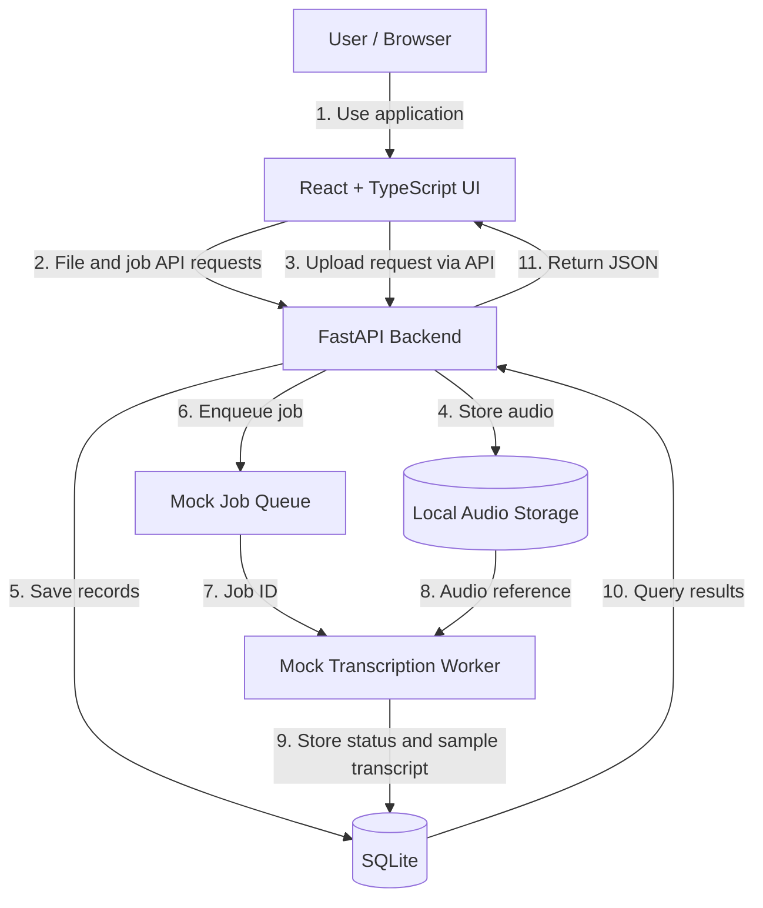

# Speech-to-Text Web App (Mock Prototype)

A local prototype of a web application for uploading recordings, tracking transcription jobs, and viewing completed transcripts. **This version does not perform real speech recognition or use live Azure services.** It is intended to validate the user experience, API contracts, and overall architecture before production integration.

## Goals

- Provide a straightforward, authenticated-style interface for managing uploaded audio files.
- Show file metadata and transcription status in a dashboard.
- Support uploading a recording and simulating asynchronous transcription.
- Display readable transcripts for completed jobs, with retry/error handling.
- Keep the frontend/backend contracts close to the intended production Azure architecture.

## Technology stack

| Layer | Current development technology | Intended production service |
|---|---|---|
| Frontend | React + TypeScript + Vite, pnpm, Oxlint | Azure Static Web Apps |
| Backend | Python + FastAPI + Uvicorn | Linux Azure App Service Web App |
| Database | SQLite + SQLAlchemy | SQL Server / Azure SQL Database |
| Authentication | Mock development identity | Microsoft Entra ID |
| Audio storage | Local file storage adapter | Azure Blob Storage |
| Background jobs | Local queue / simulated worker | Azure Queue Storage + Python worker |
| Transcription | Deterministic mock result generator | Python worker or external transcription service |
| Development environment | VS Code Dev Container | Not deployed as a container |

## Conceptual application flow



The prototype simplifies the production upload path by allowing uploads through FastAPI. In production, FastAPI is intended to authorize uploads and the browser will send file bytes directly to private Azure Blob Storage. Service adapters should keep this replacement straightforward.

## Repository layout

```text
transcription-app/
├── .devcontainer/    # VS Code development environment
├── frontend/         # React + TypeScript application
├── backend/          # FastAPI, SQLite models, mock integrations
├── AGENTS.md         # Coding-agent instructions
└── README.md         # Project overview and setup
```

> The exact internal `frontend/` and `backend/` layout can evolve during implementation.

## Run locally

Requirements: VS Code Dev Container with Python and Node.js, and **pnpm** for frontend dependency management.

**Frontend** — terminal 1:

```bash
cd frontend
pnpm install
pnpm dev --host 0.0.0.0
```

Open `http://localhost:5173`.

**Backend** — terminal 2:

```bash
cd backend
python -m venv .venv       # first run only
source .venv/bin/activate
python -m pip install -r requirements.txt
python -m uvicorn main:app --reload --host 0.0.0.0 --port 8000
```

FastAPI runs at `http://localhost:8000`; interactive API docs are available at `http://localhost:8000/docs`.

The Vite development server proxies `/api` requests to FastAPI. The backend's `requirements.txt` and startup module should be kept in sync with the implementation. The first-run SQLite initialization and sample-data seeding behavior will be documented when implemented.

## Prototype functionality

**Planned implementation:**

1. A mock sign-in/sign-out experience with a fixed development user.
2. A dashboard showing seeded recordings, file details, and job statuses.
3. A file-upload control with progress and file validation.
4. SQLite-backed file, job, and transcript records.
5. Mock queued/processing/completed/failed transitions and simulated transcription text.
6. Transcript detail display and retry for failed jobs.

The frontend should read these records via FastAPI, not store a separate authoritative set of mock data.

## API design

The backend will expose production-shaped HTTP/JSON endpoints for files, transcript retrieval, upload authorization/completion, and retry. A local-only upload route may be used for transmitting file bytes in development. See `AGENTS.md` for the proposed routes and implementation boundaries.

## What's mocked vs. real?

- **Real:** React UI, network calls from React to FastAPI, local uploaded-file persistence, SQLite operations, request/response validation, and basic job lifecycle.
- **Mocked:** Entra authentication, Azure Blob Storage, Azure Queue Storage, and speech-to-text inference. No Azure credentials are needed.

## Future production direction

Keep the replaceable interfaces while migrating:

- Mock auth → Microsoft Entra ID and server-side authorization.
- SQLite → SQL Server / Azure SQL Database.
- Local file adapter → private Azure Blob Storage and short-lived upload SAS.
- Mock queue → Azure Queue Storage.
- Simulated transcription → Python transcription worker or an external speech service.
- Local Vite/FastAPI → Azure Static Web Apps and Linux Azure App Service.

**Current priority:** Build and test the local user experience and backend contracts. Avoid premature Azure configuration or production infrastructure work.
