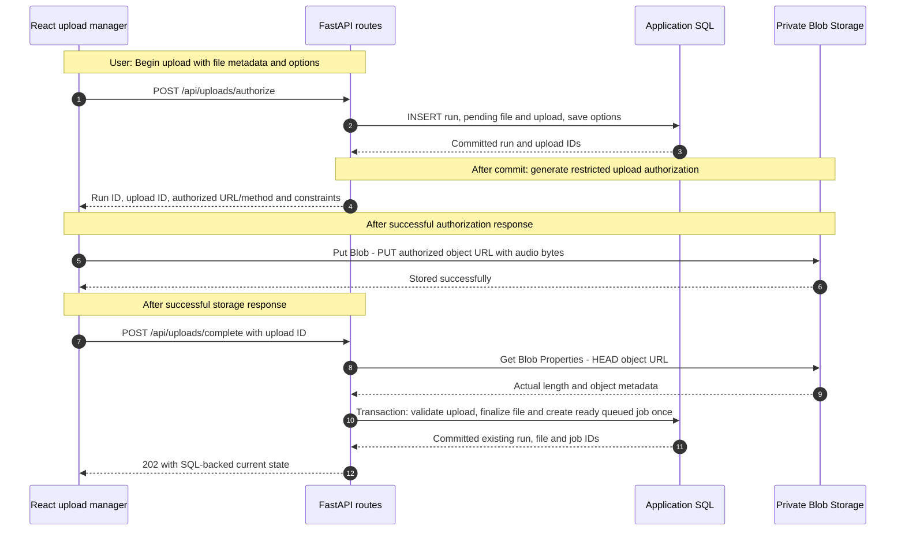
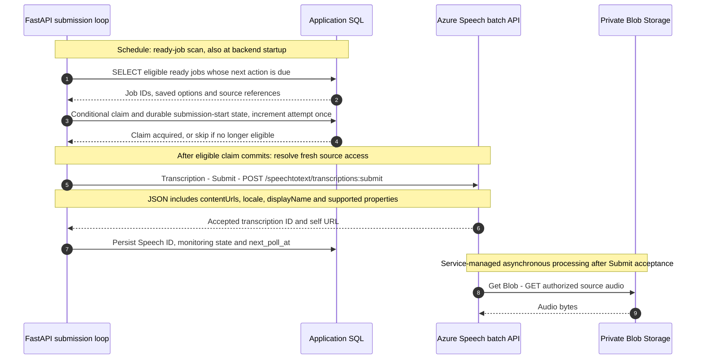
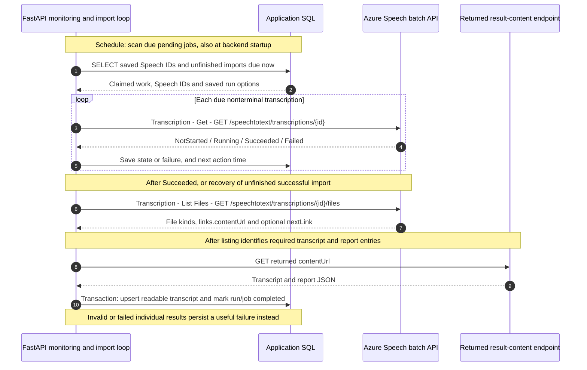
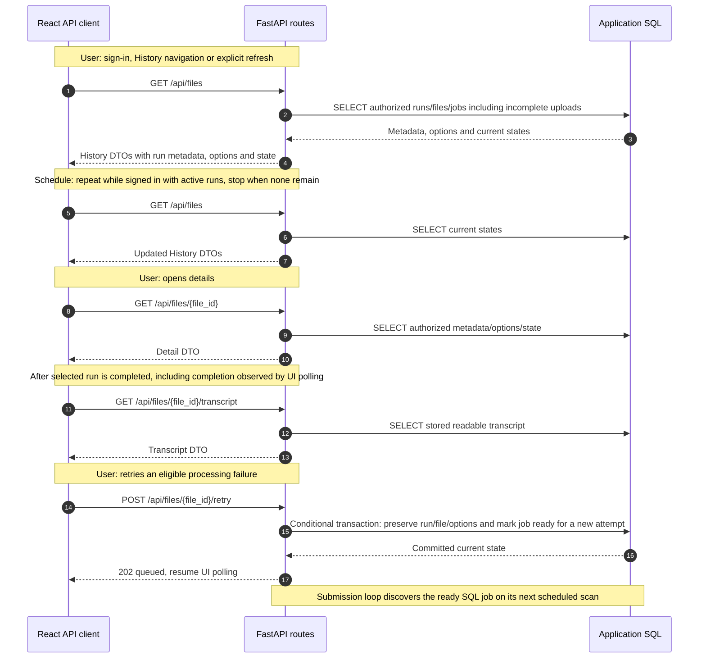

# End-state API calls and data flow

**Planned recording workflow.** Austin/John authentication is implemented as separately requested; connected History/upload processing still follows UI approval. These diagrams are an architecture reference, not the local implementation checklist. Follow the [local implementation plan](LOCAL_IMPLEMENTATION_PLAN.md) for concrete contracts and delivery order. Its run list/transcript reads and `/api/runs/{run_id}` retry/cancel routes replace the proposed file-based routes below; upload IDs still identify transfers. Local interrupted transfers restart as new submissions after reconciliation. The mock correlation lookup used for uncertain submissions is local-only and requires a verified replacement for Azure.

FastAPI hosts HTTP routes and lifespan-managed background loops. SQL stores durable workflow state; loops query due rows to execute business functions.

Production uses **Azure Static Web Apps, Azure App Service, private Azure Blob Storage, Azure SQL Database, Azure AI Speech and Microsoft Entra ID**. See the [component diagrams](IMPLEMENTATION_PLAN.md#architecture-diagrams).

## Reading these diagrams

These Mermaid sequence diagrams show calls in chronological order. Solid arrows show requests/operations; dotted arrows show responses. SQL arrows represent queries/transactions. FastAPI routes and background-loop lanes are responsibilities **inside one backend deployment**.

- **User:** an application event handler initiates the call.
- **After X:** our code explicitly calls the next operation after the preceding response/commit succeeds.
- **Schedule:** a background timer we implement queries persisted due work. Startup recovery also runs when FastAPI starts.
- **Service-managed:** Speech fetches authorized source audio after submission.

The diagrams cover explicit application integrations. Application routes are proposed contracts. Speech examples use `api-version=2024-11-15`; pin/confirm the version and supported options before implementation.

## 1. Persist the run, upload audio, mark the SQL job ready

**Implement explicitly:** shell-owned single-request transfer, measured progress, bounded-memory storage streaming, ownership/actual-byte validation and idempotent completion. Save the run/options **before** bytes move. Repeated completion returns the same records. A SQL commit makes work discoverable by the submission loop. Storage and SQL commit independently; recover abandoned objects and interrupted finalization safely.

**Open upload policy:** reconcile the preview's 4 GB limit with Speech batch's documented 1 GB input and 240-minute diarization limits before connected implementation. Preserve the preview until the decision is recorded. Interrupted transfers restart from zero.

Generate upload grants in application/library code. If user-delegation SAS is chosen, add **Get User Delegation Key** (`POST` Blob service URL with `restype=service&comp=userdelegationkey`) on cache miss/refresh. Source-read authorization may use a supported managed-identity or SAS strategy. Exact access/session design remains open. Persist provider/object key privately as durable file identity and resolve fresh access URLs when needed.

## 2. SQL-driven submission loop inside FastAPI

SQL records readiness, claims/submission-start, attempts, Speech IDs, due times and errors. Recovery resumes monitoring saved Speech IDs. Lost Submit responses/crashes require an explicit uncertain-submission state and reconciliation, because SQL and Speech commit independently.

## 3. Scheduled Speech status polling and result import

Production result URLs may point to Microsoft-managed storage; locally the Speech mock can serve them. Follow returned URLs/file-list pagination and refresh the listing if content links expire.

Check individual file/report outcomes even when the overall status is Succeeded. Import readable speaker/timestamp text according to saved options. Commit transcript (`TEXT` locally, `NVARCHAR(MAX)` in Azure SQL) and completion atomically/idempotently. Retained raw JSON can be added later using Blob references in SQL.

### Exact Speech operations and triggers

FastAPI background loops make these calls.

| Operation | Method and path | Trigger / repeat rule |
|---|---|---|
| **Transcription - Submit** | `POST /speechtotext/transcriptions:submit?api-version=2024-11-15` | After a conditional SQL claim, initially or after explicit processing retry. Existing IDs resume monitoring. |
| **Transcription - Get** | `GET /speechtotext/transcriptions/{id}?api-version=2024-11-15` | Scheduled due-job SQL scan. Startup resumes saved IDs. Stop polling terminal jobs. |
| **Transcription - List Files** | `GET /speechtotext/transcriptions/{id}/files?api-version=2024-11-15` | After successful Get, or scheduled recovery of unfinished import. Follow returned `nextLink` as needed. |
| **Result content download** | `GET {links.contentUrl}` | After List Files identifies needed entries, with bounded retries/recovery. |
| **Transcription - Delete** (optional cleanup) | `DELETE /speechtotext/transcriptions/{id}?api-version=2024-11-15` | After durable import, if an agreed retention policy calls for explicit deletion; event-triggered or scheduled cleanup. |

**Schedules:** ready-job scans, Speech status checks and browser polling run independently. Microsoft's batch guidance discourages polling more than once per minute per transcription. Persist due times and use bounded timeouts/backoff/jitter. Local mock timings can be accelerated. Browser polling reads SQL-backed state.

## 4. History, details and processing retry

Retry preserves recording/options and starts a new submission attempt through diagram 2. Restart recovery resumes the existing attempt/ID. Interrupted uploads restart transfer with reselection as needed. Protect records with ownership checks and predictable errors. Frontend polling is proposed at three seconds with one request at a time and error backoff.

## 5. Identity, cancellation, cleanup and execution lifecycle

| Explicit operation | Caller → receiver | Trigger / data flow |
|---|---|---|
| Sign-in/token acquisition | React identity adapter → Entra ID | User signs in through the chosen identity library. Configure registration/scopes and credential transport to FastAPI. Session details remain open. |
| Mock `POST /api/auth/sign-in` | React → FastAPI fixed-user adapter | Implemented: `{"access_key":"austin"}` or `{"access_key":"john"}` establishes an in-memory session identified by an HttpOnly cookie. |
| Mock `GET /api/auth/me` | React → FastAPI | Implemented startup session restoration; returns `{id, name}` or 401. Recording ownership checks follow with SQL. |
| Mock `POST /api/auth/sign-out` | React → FastAPI | Implemented local sign-out after handling active simulated transfer cancellation. Revoke the session and reset preview state. Future backend jobs continue independently. |
| Credential and ownership validation | FastAPI middleware/dependencies | Every protected request validates credentials and record ownership. |
| Cancel/report upload failure (route **TBD**) | React → FastAPI → SQL | User cancels, known transfer failure or sign-out during transfer. Abort transfer and persist cancelled/failed stage. Scheduled recovery covers interruptions missed by browser-close notifications. |
| **Get Blob Properties** — `HEAD` object URL | FastAPI routes/recovery loop → Blob | After upload completion request, or scheduled safe reconciliation of stale uploads. Validate actual stored bytes before marking work ready. |
| **Delete Blob** — `DELETE` object URL | FastAPI routes/cleanup loop → Blob | After cancellation/failure or scheduled orphan cleanup when safe. Local storage mock also owns partial-file cleanup. Preserve confirmed audio according to the retention policy. |
| Stale-upload recovery | FastAPI recovery loop → SQL and Blob | Startup plus configurable periodic sweep. Inspect stale records, verify objects where needed and persist interrupted outcomes. Use evidence of inactivity to preserve healthy slow transfers. |
| Resume submission/status/import work | FastAPI loops → SQL, Speech, result endpoint | Startup and scheduled due-row scans. Resume existing IDs/unfinished imports, recover known safe ready work, reconcile uncertain submissions. |
| Retention cleanup | FastAPI cleanup loop → SQL/Blob/Speech | Configurable schedule after retention policy is agreed. Explicit Speech deletion follows durable import. |
| `GET /api/health` | Developer/platform probe → FastAPI | On demand or configured health-probe schedule. Already implemented, independent of job coordination. |

### Background-loop implementation contract

- Use FastAPI **lifespan** to start/supervise loops and cancel/await them on shutdown. Persist scheduling/recovery state in SQL.
- Initially run **one backend process, one Uvicorn worker and one App Service instance**. Use conditional claims and add SQL-backed leases/ownership before multiple workers or instances.
- Keep requests short, use asynchronous HTTP and non-blocking waits, bounded concurrency/work per tick, and short task-scoped SQL sessions. Keep blocking SQL off the event loop as needed. Commit transactions before network calls.
- Enable App Service **Always On** on a supported plan. Loops pause during restarts/deployments and resume from SQL on startup. Backend jobs continue while backend services run.
- Test clean shutdown, task failures, overlapping scans, concurrent retries, lost Submit responses, uncertain claims, partial imports and restart recovery. Verify uncertain-submission reconciliation.

## Local replacements and remaining decisions

Local connected development uses Vite, **one main FastAPI process with loops/mock auth**, SQLite and separate storage/Speech HTTP mocks. Storage owns audio/partials, Speech owns simulated jobs/results, and main FastAPI owns application SQL.

The [local plan](LOCAL_IMPLEMENTATION_PLAN.md) defines local sessions, cancellation, proposed mock ports and recovery behavior. Remaining decisions include connected size/duration/options policy, configured recovery intervals and production credentials/source authorization/retention. Configure production managed identities/RBAC and monitoring during deployment.

See [service ownership and deployment contract](IMPLEMENTATION_PLAN.md#service-boundaries-local-now-azure-later) and [application API requirements](REQUIREMENTS.md#api-and-authentication). Speech references: [submit](https://learn.microsoft.com/en-us/azure/ai-services/speech-service/batch-transcription-create), [retrieve results](https://learn.microsoft.com/en-us/azure/ai-services/speech-service/batch-transcription-get), [audio access](https://learn.microsoft.com/en-us/azure/ai-services/speech-service/batch-transcription-audio-data), [polling guidance](https://learn.microsoft.com/en-us/azure/ai-services/speech-service/batch-transcription#best-practices-for-improving-performance).
