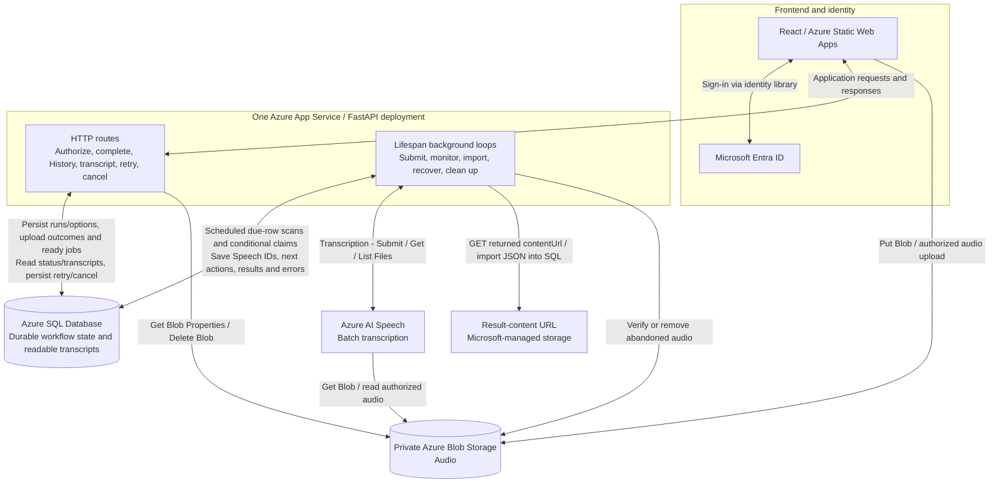
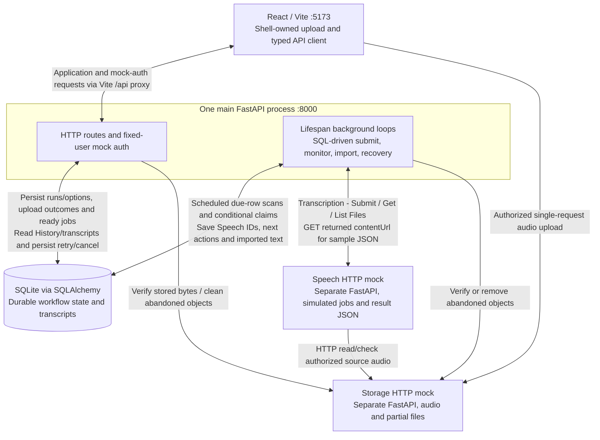

# SSScribe implementation plan

## Current status and delivery order

The React preview is implemented for review. It starts signed in on History, uses typed fixtures and simulates run progress in browser memory. FastAPI exposes `GET /api/health`. See [requirements](REQUIREMENTS.md) for coverage and [frontend guide](../frontend/README.md) for review steps.

| Step | Status |
|---|---|
| 1. History and shell | Implemented for review |
| 2. Transcript details | Implemented for review |
| 3. Preview interactions | Implemented; scenario controls need completion |
| 4. UI acceptance | Browser/accessibility review, focused tests and approval pending |
| 5–10. Connected application | Planned after UI approval |

**Delivery order:** History → details → preview interactions → UI acceptance/approval → read API spike → SQLite persistence → mock auth → real upload → Speech coordination → connected acceptance.

Use pnpm/Oxlint, the Python venv/requirements workflow, Vite's `/api` proxy and ports 5173/8000. Deliver small, reviewable changes. Proposed module paths below describe where future code can live.

## Product and architecture decisions

### Shell, navigation and runs

SSScribe uses navy accents, light/dark themes and a persistent banner containing logo/title, theme toggle, demo indicator, identity and sign-out. Signed-in navigation has Upload and History. Details open from History. Theme preference persists as `ssscribe-theme`; preview runs reset on reload.

History includes every submission and its Run ID, filename, submission time, size, requested speakers, settings and state. The current narrow-screen layout uses a scrollable table. Details show full metadata, options, attempt count, state and transcript/error actions.

A **run** represents one submission with saved options. Create it before transferring bytes. Processing retries retain run/file/options; reprocessing with changed options creates a new run. Keep upload/run state and failure stage separate from job state:

```text
Run/upload: uploading -> finalizing -> ready for processing
                    -> failed / cancelled
Job:        queued -> processing -> completed / failed
```

### Upload policy and transport

The preview validates non-empty MP3/WAV files up to **4 GB (4,000,000,000 bytes inclusive)** by extension/size. Speaker choices are Unknown/Automatic or 1–10, language English, speaker labels/timestamps default on.

**Before connected uploads:** resolve file-size/duration limits and option mapping against Speech's documented batch limits. Preserve the current preview policy until that decision is recorded.

- Create the run/options, then issue a restricted storage upload grant.
- Use a single-request transfer owned by the persistent shell so internal navigation preserves progress.
- Stream directly to the storage mock locally and private Blob Storage in production. Use bounded memory and generated object keys/temporary paths.
- Show measured bytes/percentage during transfer, then finalizing until FastAPI verifies the stored object and commits a ready SQL job.
- On interruption, restart transfer from zero with file reselection as needed. Reconcile a lost confirmation response before resending.
- Persist cancelled/failed/interrupted submissions and clean abandoned objects/partials using a configurable inactivity policy that preserves healthy slow transfers.
- Sign-out confirms cancellation of active transfer; backend processing continues while backend services run.

### Service boundaries: local now, Azure later

FastAPI owns business logic and lifespan-managed background loops. SQL stores workflow/scheduling state. Loops query due rows, conditionally claim work, submit to Speech, monitor saved Speech IDs and import results.

| Production service | Local connected implementation | Responsibility |
|---|---|---|
| Azure Static Web Apps | React/Vite | Presentation, API client and shell-owned upload |
| Azure App Service | FastAPI/Uvicorn | HTTP routes, auth adapter, business logic and background loops |
| Microsoft Entra ID | Fixed-user adapter inside FastAPI | Identity; API validates credentials and record ownership |
| Private Azure Blob Storage | Separate HTTP storage mock backed by files | Audio storage, actual-byte validation, safe streaming and cleanup |
| Azure AI Speech batch API | Separate HTTP Speech mock | Asynchronous service jobs, source-audio reads, status and result JSON |
| Azure SQL Database | SQLite through SQLAlchemy | Runs/options/files/jobs, claims, Speech IDs, due times, errors, import state and readable transcripts |

The frontend makes application calls to FastAPI and sends authorized audio directly to storage. Speech reads authorized source audio. FastAPI background loops retrieve results and save readable text in SQL. Local storage and Speech mocks own their respective data. See [API and data flow](API_DATA_FLOW.md) for exact calls and triggers.

Store `storage_provider` and object key privately in SQL, resolving fresh access URLs when needed. Public DTOs expose application IDs, metadata, options and state. Store readable transcript text as SQLite `TEXT`, later Azure SQL `NVARCHAR(MAX)`.

### Azure Speech API interaction

Batch transcription fits stored recordings and asynchronous History updates. Follow Microsoft's [batch overview](https://learn.microsoft.com/en-us/azure/ai-services/speech-service/batch-transcription), [submission guide](https://learn.microsoft.com/en-us/azure/ai-services/speech-service/batch-transcription-create), [results guide](https://learn.microsoft.com/en-us/azure/ai-services/speech-service/batch-transcription-get) and [audio access guide](https://learn.microsoft.com/en-us/azure/ai-services/speech-service/batch-transcription-audio-data).

1. **Transcription - Submit:** `POST /speechtotext/transcriptions:submit?api-version=2024-11-15`. Send `contentUrls`, locale, display name and supported properties after a conditional SQL claim and durable submission-start record.
2. Save the returned Speech ID/`self` URL and next poll time.
3. **Transcription - Get:** `GET /speechtotext/transcriptions/{id}?api-version=2024-11-15`. Scheduled due-job scans read `NotStarted`, `Running`, `Succeeded` or `Failed` and save state/errors/next-action times.
4. After success, **Transcription - List Files:** `GET /speechtotext/transcriptions/{id}/files?api-version=2024-11-15`. Follow pagination and download required transcript/report entries from returned content URLs.
5. Validate individual file outcomes and import readable text. Commit transcript/completion atomically and idempotently.
6. Resume saved IDs and unfinished imports after restart. Reconcile uncertain submissions after crashes/lost responses.

Confirm/pin the API version and payload subset before implementation. Source access uses a supported identity/SAS strategy. Production results may be hosted in Microsoft-managed storage. The local Speech mock returns deterministic sample JSON and checks source access through HTTP.

Microsoft's [batch polling guidance](https://learn.microsoft.com/en-us/azure/ai-services/speech-service/batch-transcription#best-practices-for-improving-performance) discourages polling more than once per minute per transcription. Use configurable due times, bounded timeouts and backoff; accelerate local mock timings separately. Frontend polling has its own schedule and reads application SQL-backed state.

**Open policy decision:** the [Speech quota table](https://learn.microsoft.com/en-us/azure/ai-services/speech-service/speech-services-quotas-and-limits#batch-transcription) documents **1 GB per batch input file** and **240 minutes per file with diarization**. Reconcile these with the 4 GB preview and speaker/settings controls before connected upload implementation.

### Architecture diagrams

**Planned architecture.** Backend integration follows UI approval. Request handling and background execution are code responsibilities inside one FastAPI deployment.

#### Target production architecture



Single-direction request arrows omit responses for readability. Result content is downloaded from the URL Speech returns. Configure managed identities/RBAC, source authorization and monitoring during production deployment.

#### Planned connected local mock



The storage mock streams bytes to disk; the Speech mock owns simulated jobs/results and can serve local result-content URLs. Document mock ports, browser-reachable grants and startup helpers when delivered.

#### Background-loop execution contract

- Start/supervise loops through FastAPI lifespan and cancel/await them on shutdown.
- Persist eligible work, claims/submission-start, attempts, Speech IDs, next-action times, errors and unfinished imports in SQL.
- Initially use one backend process, one Uvicorn worker and one App Service instance. Add SQL-backed ownership/leases before multiple workers/instances.
- Use async HTTP, non-blocking waits, bounded work/concurrency and backoff. Keep task-scoped SQL transactions short and commit before network calls; offload blocking SQL as needed.
- Enable App Service Always On on a supported plan. Startup scans resume durable work after restarts/deployments.
- Reconcile uncertain submissions and import idempotently. SQL and Speech transactions commit independently.
- Use distinct schedules for ready-job scans, Speech polling, upload recovery and cleanup. UI polling reads persisted state.

### Transcript persistence decision

Save readable text in SQL and commit transcript/completion together. Blob Storage can later hold retained raw JSON or exports referenced from SQL.

## 1. History and shell — implemented for review

**Requirements:** UI-01, UI-02, UI-06–UI-09.

`App.tsx` owns the shell, History, navigation, mock identity, theme and lifecycle timer. `preview.ts` owns fixtures/transitions; `components.tsx` provides shared visuals. Review list hierarchy, long filenames, responsive scrolling and focus at 320px and desktop widths.

## 2. Transcript details — implemented for review

**Requirements:** UI-04, UI-06–UI-07.

Completed runs display shared sample text with speaker/timestamp presentation. Incomplete details show state; failed details offer retry. Main receives focus on navigation. Review readability, wrapping, Back to History and return-to-origin focus.

## 3. Preview interactions — complete remaining scenarios

**Requirements:** UI-01–UI-05, UI-08–UI-09.

Preserve current Upload validation, mock sign-in/out, retry/cancel, theme and simulation. Complete explicit missing-run, upload-failure and retry-failure scenarios as needed for UI-05. Check missing/empty/invalid/over-limit file, duplicate submission and sign-out during active simulation. Keep preview labeling clear.

## 4. UI acceptance and approval

Add focused interaction tests using Vitest, React Testing Library and a DOM environment. Add a documented test script with the tooling. Cover file validation, navigation/details, retry/cancel, sign-in/out, themes and scenario recovery.

Complete keyboard, focus, announcements, contrast ≥4.5:1, reduced-motion, 320px/desktop and light/dark review. Run lint/build and the added tests. **Obtain explicit UI approval before step 5.**

## 5. Read API integration spike

**Requirements:** API-01/API-02 read subset, INT-01.

Add Pydantic DTOs and read handlers, for example `backend/schemas.py` and `backend/routes/files.py`. Preserve `main:app` and health. Add a typed `/api` client, for example `frontend/src/api/client.ts`, with cancellation, response validation and predictable errors. Use temporary labeled static backend read responses for this slice, then replace them with SQLite in step 6.

Test unknown file 404, incomplete transcript 409, unavailable backend and stale responses during selection changes. Show actionable API errors and preserve selection correctly.

## 6. SQLite persistence

**Requirements:** DATA-01–DATA-03, API-01/API-02.

Add SQLAlchemy through `requirements.txt`. Candidate modules: `database.py`, `models.py`, `services/recordings.py`, `seed.py`. Use request/task-scoped sessions and atomic writes.

Create runs/files/jobs/transcripts with saved options, upload state/failure stage, private storage keys, durable scheduling/submission/import state and readable text. Relate processing and transcripts to runs. Seed deterministic completed/retriable failed examples idempotently.

Proposed stores: `backend/data/app.db`, `backend/data/uploads/`. Add Git exclusions for DBs, sidecars, uploads and partials first. Test relationships, seeds, DTO privacy and persistence across app recreation. Document explicit development reset commands.

## 7. Mock session

**Requirements:** AUTH-01.

Implement fixed-user sign-in/me/sign-out inside FastAPI. Proposed routes are `/api/auth/sign-in`, `/api/auth/me`, `/api/auth/sign-out`. An opaque HttpOnly SameSite=Lax cookie with an in-memory session registry is a candidate local contract. Confirm it before coding.

Protect recording operations with credentials/ownership checks. Restore identity at startup; clear protected views and stop UI polling on sign-out/401. Guard stale responses. Test session restoration, unauthorized calls, ownership and sign-out races.

## 8. Actual upload and SQL readiness

**Requirements:** UP-01–UP-03, DATA-01, API-02.

Resolve connected limits/options, transport authorization and cancellation/restart routes. Implement the separate storage mock, main-API storage adapter and upload service. Persist the run/options before authorization. Stream actual bytes to generated paths with bounded memory, validate metadata/actual length and finalize storage safely.

`POST /api/uploads/complete` verifies the object, finalizes the existing run/file and creates one ready job transactionally. Repeated/concurrent confirmations return the same IDs/current state. Add the shell upload manager with measured progress and finalizing. Persist interruption/cancellation and reconcile stale objects safely.

Test exact/over-limit streams using small injected limits, actual stored-byte equality, empty/invalid files, MIME aliases/mismatches, disconnects, disk errors, repeated completion, healthy slow transfers, cleanup and restart persistence.

## 9. Speech mock and background business logic

**Requirements:** JOB-01–JOB-03, DATA-01/DATA-02, API-02 retry, QA-01.

Implement the separate Speech HTTP mock with batch submit/status/file-list/result-content, source access checks, deterministic JSON and predictable failures. Implement FastAPI lifespan submission, monitoring/import and recovery loops according to the execution contract above.

Retry preserves run/file/options, conditionally marks eligible failed work ready and starts a new Speech attempt at durable submission-start. Resume existing IDs/imports after restart. Record uncertain submissions for reconciliation and supervise loop failures.

Use controlled clocks to test transitions, failure/retry, inaccessible audio, timeouts, overlapping scans, concurrent retries, lost responses, partial imports, shutdown and restart recovery.

## 10. Connected acceptance

**Requirements:** INT-01, QA-01, DOC-01 and M2 gate.

Add conservative non-overlapping UI polling while signed in with active runs (proposed three seconds). Stop on sign-out, unmount or terminal work. Preserve selection and ignore stale responses.

Acceptance journey:

1. Start Vite, main FastAPI with loops, storage mock and Speech mock using documented commands.
2. Sign in, see labeled examples and inspect saved options/transcripts.
3. Upload an actual file, see the run before transfer finishes, navigate internally, observe measured transfer/finalizing/processing states and read the stored transcript.
4. Retry a processing failure; cancel another upload and verify its retained outcome and cleanup.
5. Verify validation, interrupted transfers, lost responses, backend outage and error recovery.
6. Reload/restart and verify records, stored bytes, seeds and resumed Speech/import work.
7. Check sign-out races, keyboard operation, responsive layout, announcements and both themes.
8. Run tests/lint/build, `git diff --check`, review Git status and record M2 acceptance.

## Commands and documentation

Current startup/check commands are in [README](../README.md#run-the-ui). Vite's `/api` proxy targets port 8000. `.vscode/tasks.json` starts the existing frontend/API; `.devcontainer/start-dev.sh` checks ports and writes logs. Update an existing Python venv explicitly after requirements changes.

Add test commands and multi-service startup/reset/cleanup instructions alongside the tooling/services that implement them. During documentation changes, verify source consistency, local links/anchors, Mermaid parsing and `git diff --check`.
