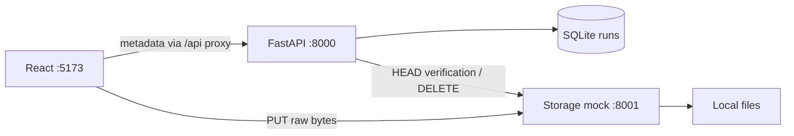

# SSScribe implementation plan

This is the single architecture and delivery plan. See [README](../README.md) for commands, [requirements](REQUIREMENTS.md) for acceptance and [source structure](PROJECT_STRUCTURE.md) for file responsibilities.

## Local implementation matrix

**✓** means the feature works in the local demo, including its mock substitute. **X** means it is not implemented locally. The Azure/live column describes production direction; no live Azure services are connected.

| Feature / purpose | Local | Current local implementation | Azure or live production equivalent |
|---|:---:|---|---|
| Workspace and theme | ✓ | React/Vite on :5173; Upload, History and details; saved light/dark preference. | React build hosted by [Azure Static Web Apps](https://learn.microsoft.com/en-us/azure/static-web-apps/overview). |
| Sign-in and session restoration | ✓ | Fixed `austin`/`john` keys; in-memory HttpOnly-cookie sessions; refresh restores sign-in, API restart requires sign-in. | [Microsoft Entra ID](https://learn.microsoft.com/en-us/entra/identity-platform/v2-overview); authentication/session integration remains to be designed. |
| Private run access | ✓ | Authenticated FastAPI routes filter by owner; unknown and other-owner run IDs return 404. | The API applies the same ownership rule using the authenticated production identity. |
| Run and transcript persistence | ✓ | One SQLite `runs` table stores options, phase/status fields, errors and imported text. | [Azure SQL Database](https://learn.microsoft.com/en-us/azure/azure-sql/database/sql-database-paas-overview?view=azuresql); schema/SQL adaptation required. |
| Explicit database setup | ✓ | `backend/src/database.py` or **Initialize Database** creates missing tables and preserves rows; API startup does not initialize SQL. | A deployment step initializes/upgrades the production schema; migration process remains to be chosen. |
| Upload policy and options | ✓ | Non-empty TXT up to 1,000,000 bytes; English, Automatic/1–10 speakers, labels/timestamps saved with each run. | Audio input policy and supported Speech option mapping remain open. |
| Direct transfer and progress | ✓ | API creates the run; browser XHR PUTs bytes to storage :8001 with measured progress and abort. Navigation preserves the transfer. | Browser [Put Blob](https://learn.microsoft.com/en-us/rest/api/storageservices/put-blob) to private Azure Blob Storage using restricted upload authorization. |
| Confirm stored bytes | ✓ | API HEAD-checks exact size before marking upload `completed`; SQL updates preserve cancellation. | Azure Blob [Get Blob Properties](https://learn.microsoft.com/en-us/rest/api/storageservices/get-blob-properties), followed by the application state update. |
| Upload cancellation/failure | ✓ | Abort the local transfer, persist cancellation and request DELETE; failed/interrupted submissions require file reselection. | Application state plus Azure Blob [Delete Blob](https://learn.microsoft.com/en-us/rest/api/storageservices/delete-blob). Processing cancellation is a separate decision. |
| Persistent blob storage | ✓ | Independent filesystem mock supports PUT/HEAD/DELETE; original filenames are storage keys and same-name uploads overwrite bytes. | Private Azure Blob Storage; production object naming/retention policy remains open. |
| Speech service contract | ✓ | Independent timed mock on :8002 supports submit, status, paginated result listings and downloads; TXT input gains one fixed sentence. | Azure Speech [batch transcription](https://learn.microsoft.com/en-us/azure/ai-services/speech-service/batch-transcription) processes audio asynchronously. |
| Background submission and polling | ✓ | One FastAPI lifespan worker runs a sequential loop in a background thread: submit, poll, import, then wait two seconds. | Application-owned orchestration around Speech REST calls; production worker hosting and polling interval remain to be decided. |
| Persist processing/recover after restart | ✓ | Save job IDs/raw status; resume confirmed jobs and imports after API restart; retry transient poll/download errors; retain uncertain submissions. | The same persisted state transitions against production SQL and Speech; multi-instance coordination remains a production decision. |
| Import and export transcript | ✓ | Follow result pagination, download JSON, atomically save readable text/completion; UI fetches text separately for display/copy/TXT download. | Speech [List Files and result download](https://learn.microsoft.com/en-us/azure/ai-services/speech-service/batch-transcription-get), with readable text stored by the application. |
| Browse History | ✓ | Load owned runs on sign-in/restore, History entry, mutation and Refresh; search/sort/paginate in React. | The same UI/API behavior against production storage. |
| Real audio transcription | X | Local input and processing use text fixtures. | Live Speech adapter, credentials, accessible audio source URLs and a verified API version. |
| Speaker labels and timestamps in output | X | Settings are stored/displayed; the mock produces plain combined text without speaker/timestamp output. | Supported Speech diarization/timestamp options and an agreed output format. |
| Signed storage access | X | Local upload URLs are unsigned; the storage mock is unauthenticated. | Restricted [shared access signatures](https://learn.microsoft.com/en-us/azure/storage/common/storage-sas-overview) for delegated blob access. |
| Manual processing retry/reconciliation | X | Failed/uncertain processing remains visible without a retry/reconciliation action. | Application workflow using persisted run state and provider status. |
| Automatic History updates | X | Users refresh History to see backend progress. | Frontend refresh strategy against the application API; mechanism remains open. |
| Automatic source/orphan cleanup | X | Source/result files persist; DELETE cannot fence an in-flight PUT. Speech expires terminal job records after 30 minutes. | Explicit source/result retention and cleanup policy; still an open decision. |
| Azure deployment | X | VS Code tasks start Vite, FastAPI and both mocks; Python processes share one local venv. | Static Web Apps for UI, [Azure App Service](https://learn.microsoft.com/en-us/azure/app-service/quickstart-python) for FastAPI, plus SQL/Blob/Speech resources and deployment configuration. |

The Python processes share `backend/.venv` and the four direct dependencies in `backend/requirements.txt`. Start them with VS Code tasks or the individual README commands. The **Initialize Database** task or explicit command creates missing tables; FastAPI does not initialize or upgrade the database. Current rows are preserved on repeated initialization. Legacy schema conversion has been retired.

The local upload policy is non-empty TXT files up to **1,000,000 bytes inclusive**. English, Automatic/1–10 speakers, labels and timestamp settings are saved with the run. Each submission creates a new row; creation is not automatically retried. There are no request IDs, deduplication indexes, preview fixtures or fake attempt counts.

## Application contracts

| Request | Current behavior |
|---|---|
| `GET /api/health` | Health |
| `POST /api/auth/sign-in` | Exact `austin` or `john` access key; HttpOnly cookie |
| `GET /api/auth/me` | Restore the current session |
| `POST /api/auth/sign-out` | Revoke the session |
| `GET /api/runs` | All rows owned by the current user; frontend handles search, sort and pages |
| `GET /api/runs/{run_id}/transcript` | Stored readable text; 409 until available |
| `POST /api/uploads/authorize` | Persist filename/size/options and return the new run, original-filename blob URL and PUT headers |
| `POST /api/uploads/complete` | HEAD-check exact stored size, then set upload completed / transcription not started |
| `POST /api/runs/{run_id}/cancel` | Persist cancellation and request blob deletion |
| `POST /api/runs/{run_id}/upload-failed` | Record upload failure |

Ownership applies to every application run operation. Other-owner and unknown IDs return 404. Run DTOs use the same field names in Python and TypeScript, including numeric IDs, `upload_stage` and `transcription_stage`. Normal reads exclude storage keys and Speech IDs. Transcript content is fetched separately.

The shell owns one upload object containing its controller, run ID and measured progress. Internal navigation preserves the transfer. History loads after sign-in/session restoration, on entering History, after mutations and on Refresh. Opening Upload/details does not reload History. Late responses cannot restore another session's state.

An interrupted or unconfirmed transfer requires file reselection and a new submission. There is no Check upload recovery control. Upload failure/cancellation stays in History. Conditional SQL updates prevent late completion/failure from overwriting cancelled or completed uploads. The small storage interface cannot fence an in-flight PUT; late orphaned bytes are a known local limitation, and cleanup automation is deferred.

Configuration: the API uses `SSSCRIBE_STORAGE_URL` for HEAD/DELETE and optional `SSSCRIBE_STORAGE_PUBLIC_URL` for browser uploads. Storage uses `SSSCRIBE_STORAGE_UI_ORIGINS` for browser CORS. See the [README](../README.md#connected-upload-configuration).

## Architecture diagrams

Implemented upload path:

## Implemented Speech processing

One worker, started by FastAPI lifespan in a background thread, runs three sequential passes over all eligible rows, ordered by run ID, then waits two seconds:

1. Submit each completed upload with `not_started` transcription and no job ID. Claim it as `submission_uncertain` before HTTP, then save the returned Speech ID, raw status and mapped stage together. Unconfirmed submissions remain uncertain without automatic resubmission.
2. Poll saved job IDs with absent, `NotStarted` or `Running` Speech status, excluding runs already marked failed. Map `NotStarted` → `queued`, `Running` → `running`, `Succeeded` → `importing` and `Failed` → `failed`. Retain raw provider values in `speech_status`.
3. Import succeeded runs still at `importing`. Follow List Files and its pagination to a Transcription entry, download its JSON, and commit readable `combinedRecognizedPhrases[].display` text and `completed` together.

Sources use backend-relative `data/blobs/audio/<original filename>`; results use `data/blobs/transcripts/<job-id>/`. Source filenames can be overwritten by later uploads. Saved speaker/label/timestamp options are metadata; the current Speech mock uses source text and locale.

Use one application process and one worker thread. Database operations are short and separate from HTTP calls. HTTP calls have three-second timeouts. A `threading.Event` stops the loop and interrupts its two-second wait. Per-run errors do not block remaining runs; shutdown finishes the current run and stops before the next one.

Temporary status/download outages retry on later cycles. Missing jobs/results and malformed transcript content become failed. Known submission rejections become failed; ambiguous outcomes remain uncertain. API restart resumes saved active jobs and imports. Speech restart clears jobs; terminal jobs still expire after 30 minutes, with files retained.

## Simplicity audit

- The worker uses one ordinary sequential Python loop in a background thread, with a stop event for waiting/shutdown. Shared submit/poll status persistence removes repeated code.
- SQL and storage/Speech clients remain direct functions. Short database operations and HTTP calls keep their existing boundaries; no dependencies were added.
- `App.tsx` keeps shared session/upload state and stale-response checks. Named page rendering removes nested JSX conditionals; explicit component props and function return types make the frontend easier to follow.

Source reductions are deliberately modest: remove repetition and unnecessary orchestration while preserving behavior, errors and recovery.

## Planned work and acceptance

Manual processing retries, reconciliation of uncertain submissions and automatic frontend History refresh remain planned. Browser interaction, keyboard/accessibility and responsive review remain pending. Production option mapping and source-file retention remain open decisions.

## Azure Speech API interaction

The local worker already uses the mock's submit, status, result listing and download operations. A live adapter must preserve those service boundaries. [API data flow](API_DATA_FLOW.md) traces the current local calls and separates the remaining live-adapter decisions.

Before enabling a live adapter, verify the API version, source-access method, supported options, input limits, duration limits and polling interval against Microsoft's [batch overview](https://learn.microsoft.com/en-us/azure/ai-services/speech-service/batch-transcription), [submission guide](https://learn.microsoft.com/en-us/azure/ai-services/speech-service/batch-transcription-create), [results guide](https://learn.microsoft.com/en-us/azure/ai-services/speech-service/batch-transcription-get) and [quota table](https://learn.microsoft.com/en-us/azure/ai-services/speech-service/speech-services-quotas-and-limits#batch-transcription).

## Validation status

Backend tests cover auth, ownership, whole-list reads, streamed bytes, direct upload completion/cancellation/failure, outages and persistence. Frontend tests cover metadata requests, direct XHR bytes/progress/abort and no automatic creation retry. Run lint, tests and build as documented in the README.

The earlier UI/auth review was approved on 2026-11-09. Connected-flow browser, keyboard/accessibility and responsive review remain pending. Real-HTTP tests cover two uploads through submission, polling, API restart and verbatim transcript import; worker tests cover per-run failures and transient import recovery.
