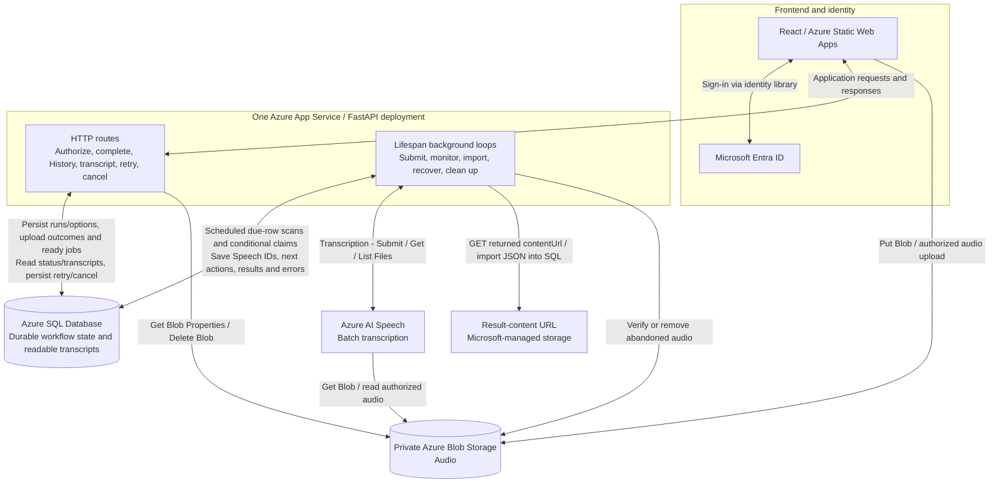
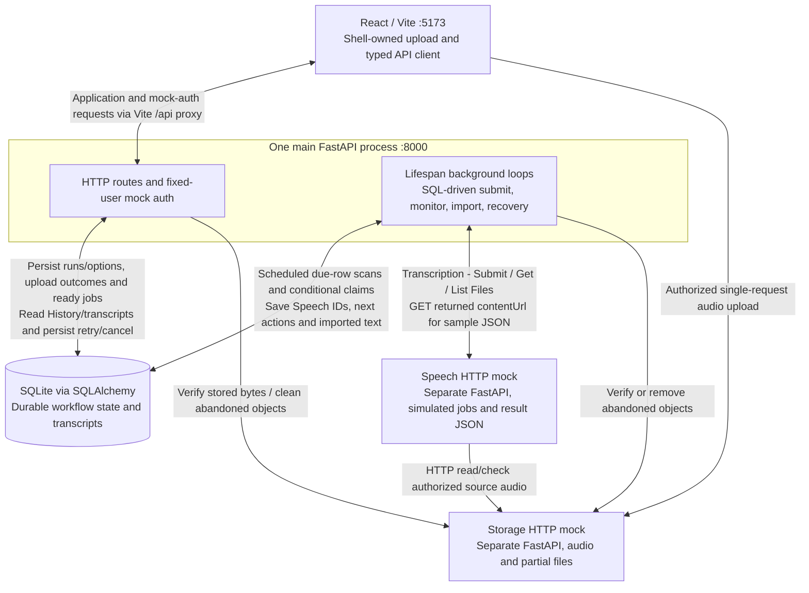

# SSScribe architecture and end-state plan

## Status and delivery guide

The React preview is implemented for review; the main FastAPI app exposes only `GET /api/health`. The standalone `backend/speech_mock.py` is also implemented: it processes local text files, writes retained results and exposes status/paginated file listings. See the [local component status table](LOCAL_IMPLEMENTATION_PLAN.md#1-small-local-architecture). UI acceptance and explicit UI approval remain pending. Backend integration follows that approval.

This document describes the application architecture and Azure end state. Use the [local implementation plan](LOCAL_IMPLEMENTATION_PLAN.md) for the ordered local delivery slices, concrete mock contracts, recovery behavior and acceptance checks. Persistent reads and auth are delivered together, followed by upload, processing and recovery.

Use [requirements](REQUIREMENTS.md) for acceptance criteria and the [frontend guide](../frontend/README.md) for UI review. The [API flow diagrams](API_DATA_FLOW.md) explain service interactions; their proposed file routes are superseded locally by run-based routes.

## Product and architecture decisions

### Shell, navigation and runs

SSScribe uses navy accents, light/dark themes and a persistent banner containing logo/title, theme toggle, demo indicator, identity and sign-out. Signed-in navigation has Upload and History. Details open from History. Theme preference persists as `ssscribe-theme`; preview runs reset on reload.

History includes every submission and its Run ID, filename, submission time, size, requested speakers, settings and state. The current narrow-screen layout uses a scrollable table. Details show full metadata, options, attempt count, state and transcript/error actions.

A **run** represents one submission with saved options. Create it before transferring bytes. Processing retries retain run/file/options; reprocessing with changed options creates a new run. Keep upload/run state and failure stage separate from job state:

```text
Run/upload: uploading -> finalizing -> ready for processing
                    -> failed / cancelled
Job:        queued -> processing -> completed / failed
```

### Upload policy and transport

The preview validates non-empty MP3/WAV files up to **4 GB (4,000,000,000 bytes inclusive)** by extension/size. Speaker choices are Unknown/Automatic or 1–10, language English, speaker labels/timestamps default on.

**Before connected uploads:** resolve file-size/duration limits and option mapping against Speech's documented batch limits. Preserve the current preview policy until that decision is recorded.

- Create the run/options, then issue a restricted storage upload grant.
- Use a single-request transfer owned by the persistent shell so internal navigation preserves progress.
- Stream directly to the storage mock locally and private Blob Storage in production. Use bounded memory and generated object keys/temporary paths.
- Show measured bytes/percentage during transfer, then finalizing until FastAPI verifies the stored object and commits a ready SQL job.
- On interruption, restart transfer from zero with file reselection as needed. Reconcile a lost confirmation response before resending.
- Persist cancelled/failed/interrupted submissions and clean abandoned objects/partials using a configurable inactivity policy that preserves healthy slow transfers.
- Sign-out confirms cancellation of active transfer; backend processing continues while backend services run.

### Service boundaries: local now, Azure later

FastAPI owns business logic and lifespan-managed background loops. SQL stores workflow/scheduling state. Loops query due rows, conditionally claim work, submit to Speech, monitor saved Speech IDs and import results.

| Production service | Local connected implementation | Responsibility |
|---|---|---|
| Azure Static Web Apps | React/Vite | Presentation, API client and shell-owned upload |
| Azure App Service | FastAPI/Uvicorn | HTTP routes, auth adapter, business logic and background loops |
| Microsoft Entra ID | Fixed-user adapter inside FastAPI | Identity; API validates credentials and record ownership |
| Private Azure Blob Storage | Separate HTTP storage mock backed by files | Audio storage, actual-byte validation, safe streaming and cleanup |
| Azure AI Speech batch API | Separate HTTP Speech mock | Asynchronous service jobs, source-audio reads, status and result JSON |
| Azure SQL Database | SQLite through SQLAlchemy | Runs/options/files/jobs, claims, Speech IDs, due times, errors, import state and readable transcripts |

The frontend makes application calls to FastAPI and sends authorized audio directly to storage. Speech reads authorized source audio. FastAPI background loops retrieve results and save readable text in SQL. Local storage and Speech mocks own their respective data. See [API and data flow](API_DATA_FLOW.md) for illustrative calls and triggers, and the [local plan](LOCAL_IMPLEMENTATION_PLAN.md#3-contracts-and-durable-state) for local contracts.

Store `storage_provider` and object key privately in SQL, resolving fresh access URLs when needed. Public DTOs expose application IDs, metadata, options and state. Store readable transcript text as SQLite `TEXT`, later Azure SQL `NVARCHAR(MAX)`.

### Azure Speech API interaction

Batch transcription fits stored recordings and asynchronous History updates. Follow Microsoft's [batch overview](https://learn.microsoft.com/en-us/azure/ai-services/speech-service/batch-transcription), [submission guide](https://learn.microsoft.com/en-us/azure/ai-services/speech-service/batch-transcription-create), [results guide](https://learn.microsoft.com/en-us/azure/ai-services/speech-service/batch-transcription-get) and [audio access guide](https://learn.microsoft.com/en-us/azure/ai-services/speech-service/batch-transcription-audio-data).

1. **Transcription - Submit:** `POST /speechtotext/transcriptions:submit?api-version=2024-11-15`. Send `contentUrls`, locale, display name and supported properties after a conditional SQL claim and durable submission-start record.
2. Save the returned Speech ID/`self` URL and next poll time.
3. **Transcription - Get:** `GET /speechtotext/transcriptions/{id}?api-version=2024-11-15`. Scheduled due-job scans read `NotStarted`, `Running`, `Succeeded` or `Failed` and save state/errors/next-action times.
4. After success, **Transcription - List Files:** `GET /speechtotext/transcriptions/{id}/files?api-version=2024-11-15`. Follow pagination and download required transcript/report entries from returned content URLs.
5. Validate individual file outcomes and import readable text. Commit transcript/completion atomically and idempotently.
6. Resume saved IDs and unfinished imports after restart. Reconcile uncertain submissions after crashes/lost responses.

Confirm/pin the API version and payload subset before implementation. Source access uses a supported identity/SAS strategy. Production results may be hosted in Microsoft-managed storage. The local Speech mock returns deterministic sample JSON and checks source access through HTTP.

Microsoft's [batch polling guidance](https://learn.microsoft.com/en-us/azure/ai-services/speech-service/batch-transcription#best-practices-for-improving-performance) discourages polling more than once per minute per transcription. Use configurable due times, bounded timeouts and backoff; accelerate local mock timings separately. Frontend polling has its own schedule and reads application SQL-backed state.

**Open policy decision:** the [Speech quota table](https://learn.microsoft.com/en-us/azure/ai-services/speech-service/speech-services-quotas-and-limits#batch-transcription) documents **1 GB per batch input file** and **240 minutes per file with diarization**. Reconcile these with the 4 GB preview and speaker/settings controls before connected upload implementation.

### Architecture diagrams

**Planned architecture.** Backend integration follows UI approval. Request handling and background execution are code responsibilities inside one FastAPI deployment.

#### Target production architecture



Single-direction request arrows omit responses for readability. Result content is downloaded from the URL Speech returns. Configure managed identities/RBAC, source authorization and monitoring during production deployment.

#### Planned connected local mock



The storage mock streams bytes to disk and retains object receipts. The Speech mock persists simulated jobs/results across restarts and serves local result-content URLs. The [local plan](LOCAL_IMPLEMENTATION_PLAN.md) defines proposed ports, source checks, browser-reachable grants and startup delivery.

#### Background-loop execution contract

- Start/supervise loops through FastAPI lifespan and cancel/await them on shutdown.
- Persist eligible work, claims/submission-start, attempts, Speech IDs, next-action times, errors and unfinished imports in SQL.
- Initially use one backend process, one Uvicorn worker and one App Service instance. Add SQL-backed ownership/leases before multiple workers/instances.
- Use async HTTP, non-blocking waits, bounded work/concurrency and backoff. Keep task-scoped SQL transactions short and commit before network calls; offload blocking SQL as needed.
- Enable App Service Always On on a supported plan. Startup scans resume durable work after restarts/deployments.
- Reconcile uncertain submissions and import idempotently. SQL and Speech transactions commit independently.
- Use distinct schedules for ready-job scans, Speech polling, upload recovery and cleanup. UI polling reads persisted state.

### Production consideration: timer and queue-triggered Azure Functions

**Optional scale-out path; defer until justified.** Keep the initial production deployment's SQL-driven App Service worker. Azure Functions with Azure Queue Storage is worth adopting when sustained due-job backlog or the need to deploy/scale background execution independently of the API warrants another deployment. Speech performs the transcription itself; adding coordination workers does not increase Speech quotas or remove provider latency. The trigger bindings are straightforward, but reliable distributed execution is not a trivial addition.

| Component | Responsibility if adopted |
|---|---|
| Timer-triggered Function | Periodically scan indexed SQL due-work rows in bounded batches and enqueue job IDs/action versions. A one-minute dispatch interval is a starting point; each job's persisted due time still controls Speech polling. |
| Azure Queue Storage | Carry small work notifications; SQL remains authoritative for state, attempts and scheduling. Audio and transcripts stay outside messages. |
| Queue-triggered Function | Claim one eligible SQL action, perform a bounded submit/status/import step using shared Python services/adapters, persist its outcome and return. Never wait inside an invocation for transcription to finish. |
| App Service | Continue serving the API. Disable the migrated background loops so there is one execution path per responsibility. |

The timer supplies the schedule; queue-triggered workers supply parallel execution. A timer invocation runs on only one instance within a Function App, even during scale-out. Queue-triggered Functions support concurrent processing and scale-out. See Microsoft's [timer behavior](https://learn.microsoft.com/en-us/azure/azure-functions/functions-bindings-timer#scale-out) and [queue trigger documentation](https://learn.microsoft.com/en-us/azure/azure-functions/functions-bindings-storage-queue-trigger).

Minimum reliability requirements before adopting:

- Treat queue delivery as at least once. Workers use conditional SQL claims with expiring leases and action versions; ignore duplicate, stale or already-completed notifications. Lease expiry must not cause an uncertain Speech submission to be blindly repeated.
- Close the SQL/enqueue gap through the scheduled SQL sweep: API requests commit ready/due state, and the timer dispatches it. A failed send leaves work eligible for a later sweep; do not mark work dispatched before sending. An expiring dispatch marker can suppress repeated notifications while preserving recovery. Duplicate sends are safe under the SQL claim. This avoids requiring a transactional outbox for this design.
- Persist the next due time before acknowledging a successful step. Release claims or recover expired ones after crashes. Keep idempotent imports and uncertain-submission reconciliation from the existing design.
- Configure bounded concurrency, HTTP timeouts, queue retry delays and poison-message handling. Alert on poisoned work and record an actionable SQL outcome; repeated scheduled redispatch must not bypass the retry policy indefinitely. Cap scale to protect SQL connections and Speech request quotas.
- Provision a Function App/hosting plan, host storage, identities/RBAC, SQL driver/configuration and monitoring. Reuse workflow functions with short-lived sessions and explicit inputs; avoid coupling them to FastAPI lifespan or request objects. Verify duplicate delivery, lease expiry and crashes between SQL updates and queue acknowledgement before switching execution.

No Functions host, queue emulator or queue abstraction is required for M2. Keep local business logic callable independently of its worker, and revisit this option using backlog/latency and operational evidence. The baseline architecture diagrams remain the initial deployment.

### Transcript persistence decision

Save readable text in SQL and commit transcript/completion together. Blob Storage can later hold retained raw JSON or exports referenced from SQL.

## 1. History and shell — implemented for review

**Requirements:** UI-01, UI-02, UI-06–UI-09.

`App.tsx` owns the shell, History, navigation, mock identity, theme and lifecycle timer. `preview.ts` owns fixtures/transitions; `components.tsx` provides shared visuals. Review list hierarchy, long filenames, responsive scrolling and focus at 320px and desktop widths.

## 2. Transcript details — implemented for review

**Requirements:** UI-04, UI-06–UI-07.

Completed runs display shared sample text with speaker/timestamp presentation. Incomplete details show state; failed details offer retry. Main receives focus on navigation. Review readability, wrapping, Back to History and return-to-origin focus.

## 3. Preview interactions — complete remaining scenarios

**Requirements:** UI-01–UI-05, UI-08–UI-09.

Preserve current Upload validation, mock sign-in/out, retry/cancel, theme and simulation. Complete explicit missing-run, upload-failure and retry-failure scenarios as needed for UI-05. Check missing/empty/invalid/over-limit file, duplicate submission and sign-out during active simulation. Keep preview labeling clear.

## 4. UI acceptance and approval

Add focused interaction tests using Vitest, React Testing Library and a DOM environment. Add a documented test script with the tooling. Cover file validation, navigation/details, retry/cancel, sign-in/out, themes and scenario recovery.

Complete keyboard, focus, announcements, contrast ≥4.5:1, reduced-motion, 320px/desktop and light/dark review. Run lint/build and the added tests. **Obtain explicit UI approval before backend integration.**

## Connected local delivery

Follow the [local implementation plan](LOCAL_IMPLEMENTATION_PLAN.md#6-delivery-slices-and-checks):

1. Persistent History and mock session, backed by SQLite from the first connected read.
2. Actual direct upload, completion, cancellation and reconciliation.
3. Durable Speech mock, background execution, transcript import and retry.
4. Service restart/outage recovery and connected acceptance.

Routes identify runs explicitly; a file may eventually have multiple runs with different settings. M2 restarts interrupted transfers as new submissions after reconciliation, and limits cancellation to uploads before readiness. Changed-option reprocessing and processing cancellation remain later work.

## Production deployment requirements

- Provision the six core services above. App Service also needs a hosting plan. Linking App Service behind Static Web Apps `/api` requires [Static Web Apps Standard](https://learn.microsoft.com/en-us/azure/static-web-apps/apis-app-service).
- Choose one authentication path (frontend Entra tokens validated by the API, or a deliberately configured platform session). Configure tenant restrictions, scopes, ownership checks and the trusted ingress boundary; a fixed-user local session does not validate production identity behavior.
- Use managed identities/RBAC where supported. Configure separate browser upload and Speech source-read authorization, Blob CORS and retention. Private objects require an explicitly supported access strategy; do not assume private network endpoints are necessary or sufficient for Speech access.
- Configure Always On and restart recovery. Before multiple workers/instances, add SQL-backed leases, bounded concurrency and tests for competing claims. Consider the [Functions and Queue Storage option](#production-consideration-timer-and-queue-triggered-azure-functions) when independent background scaling is justified.
- Validate Azure SQL schema/types, driver setup, transactions and concurrent claims against Azure SQL. SQLite/SQLAlchemy is a development boundary, not proof of equivalent locking behavior.
- Verify Speech API version/options, duration/size enforcement, polling intervals and uncertain-submission reconciliation against the real service before enabling live jobs. The local mock's correlation lookup/deduplication is not an Azure guarantee.
- Add Azure Monitor/Application Insights for request, dependency and worker failures, plus stalled-job alerts. Use Key Vault for remaining secrets when needed; keep credentials and audio/transcript contents out of logs.

## Commands and documentation

Current startup/check commands are in [README](../README.md#run-the-ui). Vite's `/api` proxy targets port 8000. `.vscode/tasks.json` starts the existing frontend/API; `.devcontainer/start-dev.sh` checks ports and writes logs. Update an existing Python venv explicitly after requirements changes.

Add test commands and multi-service startup/reset/cleanup instructions alongside the tooling/services that implement them. During documentation changes, verify source consistency, local links/anchors, Mermaid parsing and `git diff --check`.
