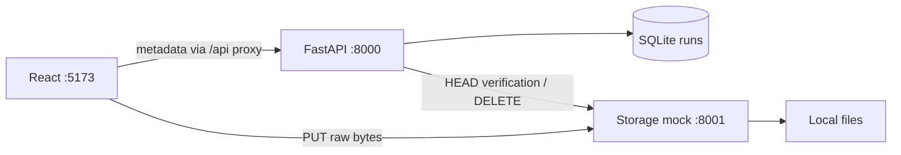

# SSScribe implementation plan

This is the single architecture and delivery plan. See [README](../README.md) for commands, [requirements](REQUIREMENTS.md) for acceptance and [source structure](PROJECT_STRUCTURE.md) for file responsibilities.

## Current local architecture

| Component | Current implementation |
|---|---|
| Frontend :5173 | React/Vite, Austin/John sign-in, owned History and direct TXT uploads |
| Application :8000 | FastAPI auth, run/transcript reads, uploads and one Speech worker |
| Application data | One SQLite `runs` table through Python `sqlite3` |
| Storage :8001 | Standalone PUT/HEAD/DELETE mock backed by files |
| Speech :8002 | Timed text-processing mock connected through submission, polling and import |

The Python processes share `backend/.venv` and the four direct dependencies in `backend/requirements.txt`. Start them with VS Code tasks or the individual README commands. The **Initialize Database** task or explicit command creates missing tables; FastAPI does not initialize or upgrade the database. Current rows are preserved on repeated initialization. Legacy schema conversion has been retired.

The local upload policy is non-empty TXT files up to **1,000,000 bytes inclusive**. English, Automatic/1–10 speakers, labels and timestamp settings are saved with the run. Each submission creates a new row; creation is not automatically retried. There are no request IDs, deduplication indexes, preview fixtures or fake attempt counts.

## Application contracts

| Request | Current behavior |
|---|---|
| `GET /api/health` | Health |
| `POST /api/auth/sign-in` | Exact `austin` or `john` access key; HttpOnly cookie |
| `GET /api/auth/me` | Restore the current session |
| `POST /api/auth/sign-out` | Revoke the session |
| `GET /api/runs` | All rows owned by the current user; frontend handles search, sort and pages |
| `GET /api/runs/{run_id}/transcript` | Stored readable text; 409 until available |
| `POST /api/uploads/authorize` | Persist filename/size/options and return the new run, original-filename blob URL and PUT headers |
| `POST /api/uploads/complete` | HEAD-check exact stored size, then set upload completed / transcription not started |
| `POST /api/runs/{run_id}/cancel` | Persist cancellation and request blob deletion |
| `POST /api/runs/{run_id}/upload-failed` | Record upload failure |

Ownership applies to every application run operation. Other-owner and unknown IDs return 404. Run DTOs use the same field names in Python and TypeScript, including numeric IDs, `upload_stage` and `transcription_stage`. Normal reads exclude storage keys and Speech IDs. Transcript content is fetched separately.

The shell owns one upload object containing its controller, run ID and measured progress. Internal navigation preserves the transfer. History loads after sign-in/session restoration, on entering History, after mutations and on Refresh. Opening Upload/details does not reload History. Late responses cannot restore another session's state.

An interrupted or unconfirmed transfer requires file reselection and a new submission. There is no Check upload recovery control. Upload failure/cancellation stays in History. Conditional SQL updates prevent late completion/failure from overwriting cancelled or completed uploads. The small storage interface cannot fence an in-flight PUT; late orphaned bytes are a known local limitation, and cleanup automation is deferred.

Configuration: the API uses `SSSCRIBE_STORAGE_URL` for HEAD/DELETE and optional `SSSCRIBE_STORAGE_PUBLIC_URL` for browser uploads. Storage uses `SSSCRIBE_STORAGE_UI_ORIGINS` for browser CORS. See the [README](../README.md#connected-upload-configuration).

## Architecture diagrams

Implemented upload path:

## Implemented Speech processing

One FastAPI lifespan worker runs three sequential passes over all eligible rows, ordered by run ID, then waits two seconds:

1. Submit each completed upload with `not_started` transcription and no job ID. Claim it as `submission_uncertain` before HTTP, then save the returned Speech ID, raw status and mapped stage together. Unconfirmed submissions remain uncertain without automatic resubmission.
2. Poll saved job IDs with absent, `NotStarted` or `Running` Speech status, excluding runs already marked failed. Map `NotStarted` → `queued`, `Running` → `running`, `Succeeded` → `importing` and `Failed` → `failed`. Retain raw provider values in `speech_status`.
3. Import succeeded runs still at `importing`. Follow List Files and its pagination to a Transcription entry, download its JSON, and commit readable `combinedRecognizedPhrases[].display` text and `completed` together.

Sources use backend-relative `data/blobs/audio/<original filename>`; results use `data/blobs/transcripts/<job-id>/`. Source filenames can be overwritten by later uploads. Saved speaker/label/timestamp options are metadata; the current Speech mock uses source text and locale.

Use one application process and one worker. Database operations are short and separate from HTTP calls. HTTP calls have three-second timeouts and run off the API event loop. Per-run errors do not block the remaining runs. Shutdown finishes the current run and stops before the next one.

Temporary status/download outages retry on later cycles. Missing jobs/results and malformed transcript content become failed. Known submission rejections become failed; ambiguous outcomes remain uncertain. API restart resumes saved active jobs and imports. Speech restart clears jobs; terminal jobs still expire after 30 minutes, with files retained.

## Planned work and acceptance

Manual processing retries, reconciliation of uncertain submissions and automatic frontend History refresh remain planned. Browser interaction, keyboard/accessibility and responsive review remain pending. Production option mapping and source-file retention remain open decisions.

## Service boundaries: local now, Azure later

| Responsibility | Local | Production direction |
|---|---|---|
| UI | React/Vite | Azure Static Web Apps |
| Application API/processing | FastAPI | Azure App Service |
| Authentication | Fixed Austin/John users | Microsoft Entra ID |
| Runs/transcript text | SQLite | Azure SQL Database |
| Uploaded bytes | Storage HTTP mock | Private Azure Blob Storage |
| Transcription | Speech HTTP mock | Azure AI Speech |

Browser uploads go directly to storage. The application owns run state and readable transcripts. Production upload authorization would generate a restricted SAS URL; the local mock does not simulate signatures. Production authentication, deployment settings and audio policy remain decisions for that slice.

## Azure Speech API interaction

The existing mock exposes submit, status, result listings and result downloads. Preserve those service boundaries when connecting it. The ordered production calls are documented in [API data flow](API_DATA_FLOW.md).

Before enabling a live adapter, verify the API version, source-access method, supported options, input limits, duration limits and polling interval against Microsoft's [batch overview](https://learn.microsoft.com/en-us/azure/ai-services/speech-service/batch-transcription), [submission guide](https://learn.microsoft.com/en-us/azure/ai-services/speech-service/batch-transcription-create), [results guide](https://learn.microsoft.com/en-us/azure/ai-services/speech-service/batch-transcription-get) and [quota table](https://learn.microsoft.com/en-us/azure/ai-services/speech-service/speech-services-quotas-and-limits#batch-transcription).

## Validation status

Backend tests cover auth, ownership, whole-list reads, streamed bytes, direct upload completion/cancellation/failure, outages and persistence. Frontend tests cover metadata requests, direct XHR bytes/progress/abort and no automatic creation retry. Run lint, tests and build as documented in the README.

The earlier UI/auth review was approved on 2026-11-09. Connected-flow browser, keyboard/accessibility and responsive review remain pending. Real-HTTP tests cover two uploads through submission, polling, API restart and verbatim transcript import; worker tests cover per-run failures and transient import recovery.
