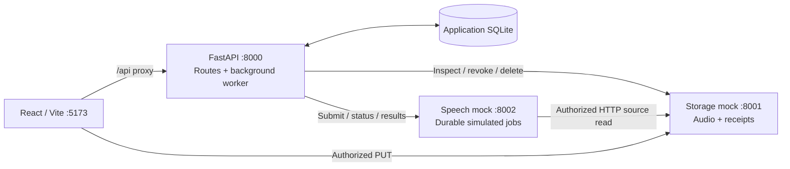

# Local implementation plan

## Status and purpose

**Standalone storage mock complete (reduced scope):** `services/storage_mock.py` implements Azure-style PUT, HEAD and DELETE on `/blobs/{name}` at port 8001. It stores text-fixture bytes on disk with a configurable 1 MB limit. No GET, grants, receipts or full service simulation is included. This user-approved interface scope supersedes the richer storage simulation proposed below. See [the storage contract](PROJECT_STRUCTURE.md#standalone-storage-mock). Application integration remains planned.

**Backend SQLite read slice complete:** API startup initializes the accepted single-table database using `sqlite3`. Authenticated `GET /api/runs` and `GET /api/runs/{run_id}/transcript` enforce ownership. The database starts empty; upload writes, UI integration and workers remain planned. See the [current database guide](../README.md#local-sqlite-database). The older SQLAlchemy/multi-table proposals below are future architecture references.

**Local authentication complete; user interaction review approved on 2026-11-09. Connected History and processing remain planned.** The current app combines a React preview with FastAPI health and Austin/John sign-in/me/sign-out endpoints. A separate minimal `services/speech_mock.py` now reads/writes local text files under `backend/data/blobs/`, with no HTTP storage dependency. Its job dictionary is in memory; the durable service architecture below remains planned. The user approved the current UI on 2026-11-09. Responsive layout review is deferred; browser/accessibility checks and focused interaction tests remain follow-up validation. Connected History/upload integration and processing remain planned; backend reads already enforce SQL ownership.

Build one usable local journey: sign in, upload a recording, follow durable progress, read a stored sample transcript, retry a processing failure and cancel an upload. Records and audio survive reloads and service restarts. Recognition is simulated and clearly labeled.

This is the delivery guide for M2 in [requirements](REQUIREMENTS.md). The [implementation plan](IMPLEMENTATION_PLAN.md) describes the target architecture and Azure end state. [API_DATA_FLOW.md](API_DATA_FLOW.md) is a sequence reference; its file-based routes and unresolved contracts are proposals. The run-based contracts and delivery order below guide local implementation.

## 1. Small local architecture

✅ = implemented for the scope stated; ❌ = not yet implemented beyond any noted scaffold. A checkmark does not mean the component is integrated with the rest of the application or that UI acceptance is complete.

| Component | Local implementation | Owns | Azure equivalent | Implemented |
|---|---|---|---|---|
| Frontend | React/TypeScript/Vite, port 5173 | UI preview and typed auth client; recording API client and actual shell-owned upload remain planned | Static Web Apps | ✅ UI complete for current scope; user approved 2026-11-09; auth integrated |
| Application | FastAPI/Uvicorn, port 8000, one worker | Health, authentication and owner-scoped SQLite run reads; upload writes and background execution remain planned | App Service | ✅ Health, auth and run reads |
| Application database | SQLite through built-in sqlite3 | Accepted single runs table with metadata, options, status and transcript | Azure SQL Database | ✅ Initialization and API reads; workflow writes pending |
| Storage mock | `services/storage_mock.py`, port 8001 | PUT/HEAD/DELETE blob interface and file bytes | Private Blob Storage | ✅ Standalone storage; application integration pending |
| Speech mock | `services/speech_mock.py`, port 8002 | Timed text processing, local source/result files, status, paginated List Files and job expiry | Azure AI Speech | ✅ Standalone local-file mock |
| Identity | Fixed Austin/John adapter inside the application | Local session and ownership checks for SQL reads | Microsoft Entra ID | ✅ Complete; user interaction review approved |

The Speech mock currently uses `backend/data/blobs/` directly and keeps jobs in memory. It does not yet call the implemented storage HTTP service. Durable jobs, service adapters and application integration remain planned.

**Planned connected architecture:** the diagram below describes the later connected milestone, including HTTP storage and durable Speech jobs.



Use the existing Python virtual environment and requirements workflow for all three Python services. Keep pnpm, Oxlint, plain CSS and Vite's `/api` proxy. Add only libraries needed for persistence, async HTTP and focused tests. A single supervised application worker can scan due SQL work for submission, monitoring, import and periodic cleanup; separate worker frameworks are unnecessary.

Bind mocks to local interfaces. Configure the browser-facing storage origin separately from service-to-service addresses so forwarded development-container ports work. Add mock port forwarding and startup instructions when the mocks are implemented; preserve ports 5173/8000. Storage CORS permits the configured UI origin, PUT/OPTIONS and required headers. Application SQL belongs only to the application; neither mock reads it.

## 2. Scope and decisions before implementation

- Keep Upload, History, details, themes and existing accessibility behavior. Retain preview fixtures only in the explicit UI-review boundary; connected mode uses API state and labels all mock/sample results.
- One file per submission; English; saved speaker/timestamp options. One active browser transfer at a time is sufficient. Backend work continues after sign-out.
- Cancel only an upload that has not been committed ready for processing. Processing cancellation and reprocessing with changed settings are later work.
- Interrupted or cancelled transfers are retained in History. After reconciliation, a user who needs to resend bytes selects the file and starts a **new run**. Processing retry retains the existing run/file/options.
- Local sessions survive browser refresh. An application restart may require signing in again; it must not lose recordings or stop durable processing from recovering.
- Search, exports, resumable/chunked upload, live recognition and multi-instance execution are outside M2.

**Policy gate before real uploads:** record the connected byte limit and supported option mapping in requirements and configuration. The preview remains at 4,000,000,000 bytes until that decision is made. Recommended connected policy is at most 1,000,000,000 bytes per file, consistent with the documented Speech batch 1 GB ceiling. Speech also documents 240 minutes per file with diarization. Decide how duration will be validated before claiming Azure-compatible acceptance. The local mock does not measure real recording duration or perform recognition; do not add media decoding solely to simulate it. If duration enforcement is deferred, document that limitation and require it before the Azure adapter is enabled. Confirm how Automatic/1–10 speakers map to the selected Speech API; speaker count is a request, not a guarantee.

## 3. Contracts and durable state

### Application API

Use Pydantic DTOs and a small typed frontend client. Return UTC timestamps, stable IDs and `{"error":{"code":"...","message":"..."}}` errors, including validation failures. Preserve the existing health response. Apply authentication and ownership checks to every protected operation; unknown or other-owner records return 404.

| Method and route | Behavior |
|---|---|
| `GET /api/health` | Existing 200 `{"status":"OK!"}`. |
| `POST /api/auth/sign-in` | Accept `{"access_key":"austin"}` or `{"access_key":"john"}` and establish that fixed user's session. Implemented. |
| `GET /api/auth/me` | Return `{id, name}`; 401 without a valid session. Implemented. |
| `POST /api/auth/sign-out` | Revoke the session and clear its cookie. Implemented. |
| `GET /api/runs` | History including incomplete uploads, saved options, state and allowed actions. |
| `GET /api/runs/{run_id}/transcript` | Stored readable text and metadata; 409 until available. |
| `POST /api/uploads/authorize` | Create run/file metadata before transfer; return run ID, upload ID, restricted URL/method, required headers and expiry. |
| `POST /api/uploads/complete` | Accept upload ID, verify storage and commit readiness once. Return current run state; repeated calls return the existing records. |
| `POST /api/runs/{run_id}/cancel` | Cancel uploading/finalizing work and schedule cleanup; repeat cancellation safely. Return 409 once processing is ready. |
| `POST /api/runs/{run_id}/retry` | Conditionally queue an eligible processing failure using the same run/file/options. Return 409 for other states. |

Authorization requests include a client-generated request ID. Enforce uniqueness per owner so retrying a lost authorization response does not create another run. Verify repeated requests match the original metadata/options. Resume a lost completion response by fetching run state and repeating completion, not by automatically uploading again. Return a DTO with run ID, file ID, filename, declared/verified byte counts, options, timestamps, state, failure stage, attempt count and allowed actions. Keep object keys, grants and Speech IDs out of ordinary History/detail DTOs; grants appear only in the authorization response.

Implemented in `backend/api/auth.py`: exact keys `austin` and `john` map to stable user IDs with those same values. An opaque HttpOnly, SameSite=Lax cookie (path `/api`) identifies an in-memory session. The frontend uses the Vite proxy, restores the session on load and handles invalid keys/backend outages. Sign-out resets shared preview state. Restarting FastAPI invalidates sessions. SQL owner filtering remains deferred; existing preview History is explicitly shared sample data. Storage uses scoped grants rather than application cookies. Do not build a user-management system.

### Application database

| Table | Minimum contents and constraints |
|---|---|
| `runs` | ID, owner, file ID, authorization request ID, immutable options, submission/update times, upload state, failure stage/error. Unique owner/request ID. |
| `files` | ID, original filename, declared type/size, verified size, private provider/object key. Generated keys; filenames never become paths. |
| `jobs` | One current job per run; state, attempt count, attempt correlation ID, durable submission-start, Speech ID, next-action time, error and import state. |
| `transcripts` | One readable transcript per run, file/job relationships and creation time. Unique run ID. |

Store the upload ID, grant expiry and cleanup/reconciliation state with the run; a separate uploads table is unnecessary for one transfer per run. Keep upload state separate from processing job state. Derive the public status in one backend helper; the frontend never advances it with a timer.

```text
Upload: uploading -> finalizing -> ready
        uploading/finalizing -> interrupted | failed | cancelled
Job:    queued -> submitting -> processing -> importing -> completed
                  |               |             |
                  +---------------+-------------+-> failed
                  -> submission_unknown -> reconcile
```

`finalizing` may be derived from verified storage evidence while completion is pending. An upload cannot become ready after cancellation; completion and cancellation use conditional SQL updates in short transactions. A unique job/run constraint prevents duplicate enqueueing. Transcript insertion and job completion commit together. Retry increments attempts only when a new submission starts, not on each click or HTTP retry.

Enable SQLite foreign keys, a bounded busy timeout and short transactions. Use synchronous SQLAlchemy sessions in synchronous handlers or offload database work from async loops; never share a session across requests/tasks or hold transactions across HTTP calls. Start with schema creation and an explicit development reset command. Add migrations when preserving evolving local data becomes necessary.

## 4. Upload and storage behavior

**Implemented local storage:** a small Azure-style PUT/HEAD/DELETE service, with no GET, authentication simulation, grant management or receipt state machine. Text-fixture uploads default to a 1,000,000-byte local limit. Temporary file writes, actual-length checks and atomic rename provide basic upload correctness. See [the current contract](PROJECT_STRUCTURE.md#standalone-storage-mock).

**Next application integration (planned):** create a run/options in SQLite before transfer, return its generated blob URL, PUT bytes from the browser, then verify existence/length with HEAD before marking the SQL run queued. DELETE can remove a stored blob. Browser progress, app-level authorization, cancellation and retry semantics will be implemented separately. Azure SAS generation belongs to the application's production adapter; there is no mock grant-issuing endpoint.

## 5. Speech mock and application worker

### Mock service

Implement only the batch subset the application calls: submit, get status, list result files and download result JSON. Keep narrow storage/Speech adapters so Azure SDK/REST details stay outside routes and workflow code. Use Speech-like status values and result structure, with one input file per job.

The Speech mock owns a small durable SQLite store for job IDs, source references, timing, outcome and sample results. Compute deterministic progress from saved timestamps rather than one sleeping task per job. Read/check source audio through an authorized storage HTTP request with bounded memory before reporting success. Persist that check or repeat it safely after restart. A restarted mock must not forget IDs already saved by the application.

Provide a normal result and one deterministic fail-once fixture that succeeds on explicit processing retry. Use small valid fixture audio and deterministic seed IDs; seed required mock objects/jobs idempotently through their service boundaries. Tests can inject timeouts, missing source and malformed results without adding product controls. All transcripts remain labeled samples.

### Worker and recovery

- Start one supervised worker with FastAPI lifespan and one shared async HTTP client. A short tick scans a bounded number of due rows; begin with sequential execution and bounded HTTP timeouts. Run upload recovery/cleanup less frequently within that worker.
- Conditionally claim a queued job and commit a durable submission-start with its attempt correlation ID before calling Speech. Save returned Speech ID before monitoring. Existing IDs are polled, never resubmitted on startup.
- Persist `next_action_at` and use bounded backoff for transport failures. Local mock timings can be seconds; keep production polling configuration separate. Do not fail a valid processing job merely because a service briefly restarts.
- After success, fetch listed results, validate the individual file outcome, render readable text according to saved settings and commit transcript/completion once. Resume unfinished imports after restart. Bound result downloads and follow supported pagination through the adapter.
- Log task failures with run/job IDs and keep the worker alive through recoverable errors. Cancel and await it on shutdown. An unexpected worker exit must be visible through logging and a documented readiness/worker-status check.

**Uncertain submission is a real boundary:** a timeout after POST does not prove rejection. Persist `submission_unknown`; do not blindly submit again. For the local mock, provide a private lookup by the saved attempt correlation ID, atomically deduplicated by the mock. Reconcile that attempt before proceeding. This helper is a local testing contract, not a claim that Azure Speech supports an idempotency key. The production adapter needs a verified reconciliation strategy before live submission is enabled. If reconciliation is unavailable, retain the uncertain state and expose an actionable message rather than offer an unsafe retry.

One application process/worker owns workflow execution locally. Conditional updates and uniqueness constraints still protect duplicate API calls. SQL leases and multi-instance scheduling belong to a later scale-out milestone.

## 6. Delivery slices and checks

Implement and verify each slice before proceeding. Do not create a temporary static read API that is immediately replaced by SQLite.

| Slice | Deliverable | Evidence to proceed |
|---|---|---|
| 0. UI acceptance — complete for current scope | User approved sign-in, Upload, History and transcript details on 2026-11-09. Responsive layout review is deferred; browser/accessibility checks and focused interaction tests remain follow-up work. | Explicit UI approval recorded; lint/build pass. Connected workflow acceptance remains separate. |
| 1. Persistent History (auth implemented) | Data exclusions, SQLite models, user-owned run DTOs/routes, recording API client and API-backed History/details. Seed labeled completed examples; add the retriable example when its source exists. | Refresh retains session/data; restart retains data; signed-out and other-owner reads fail; missing/incomplete transcript states work. |
| 2. Real upload | Record connected policy; storage mock, authorization/idempotency, streaming, completion, shell progress, cancellation and upload reconciliation. | Stored bytes equal input; exact/over-limit checks; navigation preserves transfer; duplicate completion creates one job; lost completion/cancel/disconnect recover correctly. |
| 3. Processing and retry | Durable Speech mock, adapters, supervised worker, result import and processing retry. | Upload reaches stored transcript; failure retries once; duplicate retry does not submit twice; mock checks source through HTTP. |
| 4. Recovery and acceptance | Finish startup sweeps, uncertain-submit reconciliation, outage backoff, cleanup and full UI polling/error handling. | Restart each service during upload/processing/import; resume existing work without duplicate records/jobs/transcripts; complete the journey below. |

Introduce non-overlapping browser polling when active API-backed work first exists. Default to about three seconds with backoff; stop on sign-out, unmount or terminal work. Refresh after mutations and when returning to History. Use cancellation/session generation guards so late responses cannot restore signed-out data or replace another run's details. Keep upload transport errors distinct from application-service errors; a temporary API outage after a successful PUT should prompt completion reconciliation.

At sign-out, confirm cancellation of an active transfer, abort it and request cancellation while credentials remain valid, then revoke the session and clear protected state. If the API is unreachable, clear local protected state and report that cancellation/sign-out could not be confirmed; startup recovery reconciles persisted upload work. Processing continues independently of the browser.

Current auth checks use standard-library unittest over real HTTP (`backend/.venv/bin/python -m unittest discover -s backend/tests -v` from the repository root), covering both users, cookies, invalid/forged credentials, sign-out, session replacement and restart. Add pytest with isolated temporary databases/storage and controlled clocks for future workflow/service checks, and Vitest/React Testing Library for core UI interactions. Prioritize boundaries: unauthorized access, actual bytes, races, retry, recovery and atomic import. Test injected small limits rather than allocating gigabyte files. Add a small real-HTTP integration check across all three Python services; HTTP stubs alone do not validate the service boundary.

## 7. Files, startup and completion

Candidate maintained modules, added only as needed:

| Area | Proposed location |
|---|---|
| Database, DTOs, auth and routes | `backend/src/database.py`, `backend/src/schema.sql`, `backend/api/auth.py`, `backend/api/runs.py` |
| Workflow and external clients | `backend/src/processing.py`, `backend/src/worker.py` (when implemented) |
| Separate mocks | `services/storage_mock.py`, `services/speech_mock.py` |
| Backend tests | `backend/tests/` |
| Frontend API and transfer ownership | `frontend/src/api/`, `frontend/src/useUpload.ts` |

Preserve `backend/main.py` and `uvicorn main:app`. Keep `backend/data/` ignored, including SQLite sidecars, grants, audio, partials and mock state, with an exception for maintained `example*` files directly inside `backend/data/blobs/audio/`. Proposed stores: application `backend/data/app.db`, storage `backend/data/storage/` with blob files (implemented), and Speech `backend/data/speech.db`. No runtime stores are committed.

Provide documented commands to start Vite and all three Python services, configure URLs/credentials, seed once, run checks, stop services and explicitly reset local data. Extend the existing startup helper after individual commands work; check ports without killing unrelated processes. Startup waits/retries for dependencies; a temporarily absent mock must not erase state. Logs identify the service and run/job but exclude credentials, grants and transcript contents.

M2 is complete when a developer can follow the README to:

1. Start services, sign in and inspect labeled seeded History/transcripts.
2. Upload real MP3/WAV bytes, navigate during transfer, see queued/processing/completed and read stored sample text.
3. Retry a deterministic processing failure and cancel a different active upload, retaining both outcomes.
4. Recover a lost completion response, interrupted upload and temporary mock/API outage with useful UI messages.
5. Reload the browser and restart all services, retaining data and resuming saved Speech IDs/imports.
6. Verify that cancellation/cleanup cannot queue work, uncertain submission cannot duplicate work and healthy slow transfers survive recovery sweeps.
7. Pass focused backend/UI checks, `pnpm lint`, `pnpm build`, browser accessibility review and `git diff --check`.

Update [README](../README.md), [project structure](PROJECT_STRUCTURE.md), requirements and this guide as slices land. Record policy choices and actual commands where implemented; keep planned and current behavior separate.
